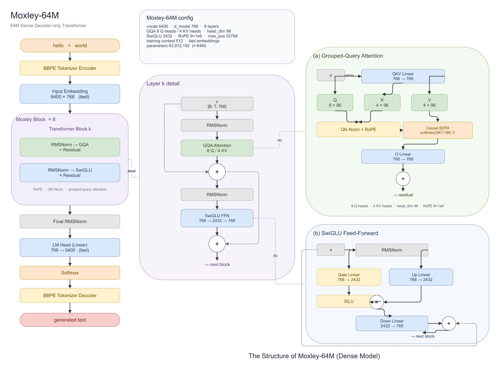

# Moxley

[](https://github.com/adrian-mo61/moxley/actions/workflows/tests.yml)
[](LICENSE)
[](#1-模型规格)

**Moxley** 是一个从零实现、可复现的 **64M 参数语言模型预训练项目**。它参考了
[MiniMind](https://github.com/jingyaogong/minimind) 的 64M Dense 架构与数据配方，
但模型、BBPE 分词器、JSONL → `.bin` 转换器和训练循环都是独立、精简、可读的实现。

项目目标不是堆叠框架，而是把一条完整链路讲清楚：

- **预训练**：BBPE 6400 词表 + `pretrain_t2t.jsonl` → uint16 `.bin` → Moxley-64M
- **SFT**：`sft_t2t.jsonl` → ChatML + assistant-only loss mask → 对话模型
- **4090 脚本**：预训练与 SFT 各有对应的一键脚本

```text
pretrain_t2t.jsonl
      │
      ├─ BBPE 分词器训练（6400 词表）
      │
      └─ 流式转换为 uint16 二进制
             │
             ├─ train.bin
             └─ val.bin
                    │
                    └─ Moxley-64M 预训练
                           │
                           └─ 采样 / 续训 / 部署
```

> 本仓库提交的是**代码、分词器和可复现脚本**。8.27 GB 的原始语料、数 GB 的
> `.bin` 文件以及训练权重都太大，不适合放进 Git，已通过 `.gitignore` 排除。
> 按下面的命令可以在本地完整重建。

---

## 1. 模型规格

Moxley-64M 采用 Llama / Qwen 风格的 decoder-only Transformer：



> 可编辑源文件：[DrawIO](docs/moxley_architecture.drawio) · [SVG](docs/moxley_architecture.svg)

| 项目 | 配置 |
|---|---|
| 参数量 | **63,912,192（约 63.9M）** |
| 层数 | 8 |
| hidden size | 768 |
| attention heads | 8（head_dim = 96） |
| KV heads | 4（GQA，2 个 query head 共享 1 组 KV） |
| FFN | SwiGLU，intermediate size = 2432 |
| 归一化 | Pre-RMSNorm；Q/K 每个 head 额外做 RMSNorm |
| 位置编码 | RoPE，`theta = 1,000,000`，最大位置 32768 |
| 词表 | 6400（BBPE，36 个特殊 token） |
| 输入/输出嵌入 | tied（共享权重） |
| 上下文长度 | 训练默认 512 tokens |

参数拆解：

| 模块 | 参数量 |
|---|---:|
| token embedding（6400 × 768） | 4,915,200 |
| 8 × Transformer block | 58,996,224 |
| final RMSNorm | 768 |
| lm_head | 与 embedding 共享 |
| **合计** | **63,912,192** |

单个 block 的参数：

| 模块 | 参数量 |
|---|---:|
| q_proj / o_proj | 1,179,648 |
| k_proj / v_proj | 589,824 |
| q_norm / k_norm | 192 |
| SwiGLU（gate/up/down） | 5,603,328 |
| 2 × RMSNorm | 1,536 |
| **合计** | **7,374,528** |

`configs/moxley_64m.json` 是默认配置，`configs/moxley_debug.json` 是给单元测试和
CPU 冒烟训练用的 0.1M 小模型配置。

---

## 2. 快速开始

### 2.1 安装

```bash
python -m venv .venv
# Windows: .venv\Scripts\activate
# Linux/macOS: source .venv/bin/activate
pip install -r requirements.txt
```

要求 Python ≥ 3.9、PyTorch ≥ 2.1。GPU 训练建议 CUDA 12.x；CPU 也能跑通小规模
冒烟训练，但完整预训练会很慢。

### 2.2 下载预训练语料

使用 ModelScope（国内网络通常更稳定）：

```bash
modelscope download \
  --dataset gongjy/minimind_dataset \
  pretrain_t2t.jsonl \
  --local_dir data \
  --max-workers 8
```

或从 Hugging Face 下载：

```text
https://huggingface.co/datasets/jingyaogong/minimind_dataset
```

文件应位于 `data/pretrain_t2t.jsonl`，大小约 **8.27 GB**。数据格式为：

```json
{"text": "人工智能是计算机科学的一个分支……"}
{"text": "清晨的阳光透过窗帘洒进房间……"}
```

如果是快速体验，也可以用仓库自带的 20 条样例：

```bash
python scripts/train_tokenizer.py \
  --input data/sample.jsonl \
  --output out/debug/tokenizer \
  --vocab-size 512 \
  --overwrite
```

### 2.3 训练 BBPE 分词器

```bash
python scripts/train_tokenizer.py \
  --input data/pretrain_t2t.jsonl \
  --output data/tokenizer \
  --vocab-size 6400
```

默认从 `pretrain_t2t.jsonl` 前部读取 **1 亿字符**（约 100 MB 中文）训练 BPE。
对 6400 词表来说这已经足够，也能把训练时间控制在十分钟左右；想用全量语料时加
`--max-chars 0 --max-doc-chars 0`。

产物：

```text
data/tokenizer/
├── tokenizer.json          # 主文件，训练和推理都读取它
├── vocab.json              # BPE 词表，便于查看
├── merges.txt              # BPE 合并规则
├── tokenizer_config.json   # BOS/EOS/PAD 等配置
├── special_tokens_map.json
└── tokenizer_meta.json     # 训练参数、压缩率、特殊 token id
```

特殊 token 的前三个 id 与 MiniMind 保持一致：

| token | id | 用途 |
|---|---:|---|
| `<|endoftext|>` | 0 | pad / unk |
| `<|im_start|>` | 1 | BOS |
| `<|im_end|>` | 2 | EOS |

仓库附带的分词器（`data/tokenizer/`）在 `pretrain_t2t.jsonl` 前 **1 亿字符**上训练，
单机 CPU 约 **9.5 分钟**，词表达到 6400。抽样测试：

| 文本 | 字符数 | tokens | 字符/token |
|---|---:|---:|---:|
| 中文技术说明 | 56 | 32 | 1.75 |
| 英文技术说明 | 105 | 47 | 2.23 |
| 中英混合 | 91 | 45 | 2.02 |
| emoji / 空白 / 换行 | 25 | 21 | 1.19 |

所有样例的 encode → decode 均能无损还原。完整训练参数和压缩率记录在
`data/tokenizer/tokenizer_meta.json`。

### 2.4 JSONL → `.bin`

```bash
python scripts/prepare_data.py \
  --input data/pretrain_t2t.jsonl \
  --tokenizer data/tokenizer \
  --output-dir data/bin \
  --val-ratio 0.005
```

转换是流式的，不会把整个语料读进内存。输出：

```text
data/bin/
├── train.bin     # uint16 token 流
├── val.bin       # 约 0.5% 文档作为验证集
└── meta.json     # token 数、文档数、分词器哈希、BOS/EOS id
```

文档之间用 `[BOS] + text_tokens + [EOS]` 拼接，不做 padding。训练时按固定长度
切块并打乱块顺序，因此不会把 padding 计入 loss。

估算：在本语料的抽样上，总体约 **1.53 字符/token**；中文通常 1.7～2.1
字符/token，英文约 2.2 字符/token。8.27 GB 原始 JSONL 转换后得到约 **4.23 GB**
的 token 流（uint16）。

完整语料的实际转换结果（本仓库验证时生成，记录在
[`data/bin_meta.json`](data/bin_meta.json)）：

| 指标 | 数值 |
|---|---:|
| 源文件 | 8,275,074,893 B |
| 文档数 | 8,468,827 |
| 字符数 | 3,243,816,525 |
| token 数 | 2,125,420,788 |
| train.bin | 4,229,560,810 B（3.94 GiB） |
| val.bin | 21,280,766 B |
| 转换耗时 | 1,085 s（约 18 分钟，CPU） |
| 转换速度 | 1.96M tokens/s |

`train.bin` 里共有 2,114,780,405 个训练 token，按 `seq_len=512` 可切出约
4,130,430 个 block。

仓库自带一份用完整 6400 词表转换好的小样本：

```text
data/sample_bin/
├── train.bin     # 1,357 tokens
├── val.bin       # 266 tokens
└── meta.json
```

可以用它验证训练循环（CPU 也可）：

```bash
python train_pretrain.py \
  --data-dir data/sample_bin \
  --out-dir out/sample-smoke \
  --seq-len 64 \
  --batch-size 1 \
  --grad-accum 1 \
  --max-steps 1 \
  --eval-interval 1 \
  --device cpu
```

### 2.5 预训练

单卡默认配置（24 GB 显存左右比较宽松）：

```bash
python train_pretrain.py \
  --config configs/moxley_64m.json \
  --data-dir data/bin \
  --out-dir out/moxley-64m \
  --seq-len 512 \
  --batch-size 32 \
  --grad-accum 8 \
  --epochs 1 \
  --lr 5e-4
```

有效 batch 为 `32 × 8 × 512 = 131,072` tokens/step。脚本包含：

- AdamW（`betas=(0.9, 0.95)`，weight decay 0.1）
- 线性 warmup + cosine decay 到 `min_lr`
- bf16 / fp16 autocast（CUDA），CPU 自动使用 fp32
- 梯度累积、梯度裁剪
- 定期验证、CSV 日志、`latest.pt` 断点续训
- 训练结束导出 `out/moxley-64m/final/`（`config.json` + `pytorch_model.bin`）

显存紧张时优先降低 `--batch-size`，保持 `batch_size × grad_accum` 不变：

```bash
python train_pretrain.py \
  --batch-size 8 --grad-accum 32 \
  --out-dir out/moxley-64m
```

先跑 20 步确认环境：

```bash
python train_pretrain.py \
  --data-dir data/bin \
  --out-dir out/smoke \
  --seq-len 256 \
  --batch-size 4 \
  --grad-accum 2 \
  --max-steps 20 \
  --eval-interval 20 \
  --save-interval 0
```

中断后继续：

```bash
python train_pretrain.py \
  --data-dir data/bin \
  --out-dir out/moxley-64m
```

训练代码本身会自动检测 `out/moxley-64m/latest.pt`：存在就恢复模型、优化器、
scaler、step、epoch 以及 epoch 内 batch 位置；不存在则从头开始。

```bash
# 强制要求恢复，没有 checkpoint 就报错
python train_pretrain.py --data-dir data/bin --out-dir out/moxley-64m --resume

# 忽略旧 checkpoint，从头训练
python train_pretrain.py --data-dir data/bin --out-dir out/moxley-64m --fresh
```

训练时会显示 tqdm 进度条；不需要时可以加 `--no-progress`。

### 2.6 Ubuntu + RTX 4090 一键脚本

Git 仓库里没有 4.2 GB 的 `train.bin`，所以云端需要先上传 `.bin` 文件，或者在
云端重新从 JSONL 转换。

**在本机（Windows PowerShell）上传数据：**

```powershell
ssh USER@HOST "mkdir -p ~/moxley/data/bin"
scp data/bin/train.bin data/bin/val.bin data/bin/meta.json USER@HOST:~/moxley/data/bin/
```

**在 Ubuntu 云主机上：**

```bash
git clone https://github.com/adrian-mo61/moxley.git
cd moxley
SETUP=1 bash scripts/train_4090.sh
```

`SETUP=1` 会创建 `.venv`，安装 CUDA 12.1 版 PyTorch，然后开始预训练。如果环境
已经配置好，直接运行：

```bash
bash scripts/train_4090.sh
```

如果 `data/bin/train.bin` 不存在，但机器上已有 `data/pretrain_t2t.jsonl` 和
`data/tokenizer/`，脚本会自动先执行 JSONL → `.bin` 转换。也可以先在云端下载
原始语料再启动：

```bash
pip install modelscope
modelscope download --dataset gongjy/minimind_dataset pretrain_t2t.jsonl --local_dir data
SETUP=1 bash scripts/train_4090.sh
```

脚本默认值（针对 24 GB 显存的 4090）：

| 环境变量 | 默认值 | 说明 |
|---|---|---|
| `SEQ_LEN` | 512 | 训练上下文长度 |
| `BATCH_SIZE` | 32 | 单次前向的样本数 |
| `GRAD_ACCUM` | 8 | 梯度累积步数 |
| 有效 batch | 131,072 tokens/step | `32 × 8 × 512` |
| `DTYPE` | bf16 | 4090 支持 bfloat16 |
| `EPOCHS` | 1 | 2.11B 训练 token 一轮 |
| `LR` | 5e-4 | 与通用脚本一致 |
| `EVAL_INTERVAL` | 500 | 每 500 步验证 |
| `SAVE_INTERVAL` | 1000 | 每 1000 步存 `latest.pt` |
| `NUM_WORKERS` | 8 | 按云主机 vCPU 数调整 |
| `OUT_DIR` | `out/moxley-64m-4090` | 日志和权重目录 |
| `RESUME` | `auto` | 自动检测 `latest.pt`；`0` 从头，`1` 强制续训 |
| `PROGRESS` | `1` | 显示 tqdm 进度条；`0` 关闭 |

训练时终端会显示 tqdm 进度条，包含 step、loss、lr、tok/s 和预计剩余时间；
`train.log` 里同时保留关键步骤日志。

按 2.11B 训练 token 计算，默认配置约 **16,134 个 optimizer step**，纯计算量约
**811 PFLOPs**。4090 的实际耗时主要取决于功耗限制和训练吞吐：

| 实测吞吐 | 预计耗时 |
|---:|---:|
| 50k tokens/s | 约 11.7 小时 |
| 80k tokens/s | 约 7.3 小时 |
| 120k tokens/s | 约 4.9 小时 |

**预估：默认配置下约 5～10 小时**，加上验证/保存开销通常再多 5%～10%。开跑后
直接看日志里的 `tok/s`，用 `2,114,780,405 ÷ tok/s ÷ 3600` 就能换算剩余小时数。

**先跑 20 步确认环境：**

```bash
MAX_STEPS=20 \
BATCH_SIZE=4 \
GRAD_ACCUM=1 \
WARMUP_STEPS=10 \
EVAL_INTERVAL=10 \
SAVE_INTERVAL=0 \
OUT_DIR=out/smoke-4090 \
bash scripts/train_4090.sh
```

**显存不足时**，保持有效 batch 不变，降低单次 batch、提高累积：

```bash
BATCH_SIZE=16 GRAD_ACCUM=16 bash scripts/train_4090.sh
# 仍 OOM：
BATCH_SIZE=8 GRAD_ACCUM=32 bash scripts/train_4090.sh
BATCH_SIZE=4 GRAD_ACCUM=64 bash scripts/train_4090.sh
```

**断点续训：**

默认情况下，只要 `out/moxley-64m-4090/latest.pt` 存在，再次运行脚本就会自动
恢复模型、优化器、step 和 epoch 内位置，不需要额外参数。

```bash
# 自动续训（默认行为）
bash scripts/train_4090.sh

# 强制要求存在 checkpoint，不存在则报错
RESUME=1 bash scripts/train_4090.sh

# 忽略旧 checkpoint，从头开始
RESUME=0 bash scripts/train_4090.sh
```

**建议放在 screen 里跑：**

```bash
# 如果云主机没有 screen：
sudo apt update && sudo apt install -y screen

screen -S moxley

# 在 screen 内运行训练命令
bash scripts/train_4090.sh

# 按 Ctrl-a 再按 d 脱离
# screen -ls          查看会话
# screen -r moxley    重新连接
```

日志与检查点：

```text
out/moxley-64m-4090/
├── train_log.csv
├── train.log
├── latest.pt          # 断点续训
├── final.pt
└── final/
    ├── config.json
    └── pytorch_model.bin
```

### 2.7 生成

```bash
python scripts/generate.py \
  --model out/moxley-64m/final \
  --tokenizer data/tokenizer \
  --prompt "人工智能的未来是" \
  --max-new-tokens 128 \
  --temperature 0.8 \
  --top-k 50 \
  --top-p 0.9
```

`--temperature 0` 等价于贪心解码。生成脚本默认使用 KV cache；加 `--no-cache`
可以走完整重算路径，便于对比。

生成脚本默认启用：

```text
--repetition-penalty 1.1
--no-repeat-ngram-size 4
```

小模型（尤其是 SFT 早期 checkpoint）很容易反复输出同一段话。`repetition_penalty`
会惩罚已出现 token，`no_repeat_ngram_size=4` 会禁止 4-gram 完全重复。仍然循环时
可以提高到 `1.15`～`1.25`，或关闭 n-gram 限制观察模型原始分布：

```bash
python scripts/generate.py ... --repetition-penalty 1.2 --no-repeat-ngram-size 0
```

### 2.8 SFT：使用 sft_t2t.jsonl

SFT 阶段读取 MiniMind 的 `sft_t2t.jsonl`，统一转换成 ChatML：

```text
<|im_start|>system
...
<|im_end|>
<|im_start|>user
...
<|im_end|>
<|im_start|>assistant
...
<|im_end|>
```

**只有 assistant 内容（含结尾的 `<|im_end|>`）参与 loss**，system / user / tool
内容全部 mask 成 `-100`。这样可以避免模型学习复述用户问题。

#### 1. 转成 SFT 二进制

```bash
python scripts/prepare_sft.py \
  --input data/sft_t2t.jsonl \
  --tokenizer data/tokenizer \
  --output-dir data/sft_bin \
  --max-len 1024 \
  --val-ratio 0.005
```

产物：

```text
data/sft_bin/
├── tokens.bin          # uint16，所有样本首尾相接
├── mask.bin            # uint8，1 = assistant token
├── offsets.npy         # int64，每条样本的起止 offset
├── train_indices.npy
├── val_indices.npy
└── meta.json
```

完整 `sft_t2t.jsonl` 的实际转换结果（记录在
[`data/sft_bin_meta.json`](data/sft_bin_meta.json)）：

| 指标 | 数值 |
|---|---:|
| 源文件 | 14,096,018,369 B |
| 原始 conversations | 5,109,432 |
| 可用样本 | 5,052,557 |
| 字符数 | 8,811,125,028 |
| token 数 | 3,683,151,995 |
| `tokens.bin` | 7,366,303,990 B |
| `mask.bin` | 3,683,151,995 B |
| 训练集 | 5,027,294 样本 / 3,664,695,793 token |
| 验证集 | 25,263 样本 / 18,456,202 token |
| 转换耗时 | 4,635.8 s（约 77 分钟，CPU） |

`max_len=1024` 会截断部分超长对话（本次有 1,499,292 条触及上限）；如果更在意长对话
完整性，可以改用 `--max-len 2048` 重新转换，但显存和训练时间会增加。

只想先验证流程时，可以只转前 1000 条：

```bash
python scripts/prepare_sft.py \
  --input data/sft_t2t.jsonl \
  --tokenizer data/tokenizer \
  --output-dir out/sft_1k \
  --max-len 1024 \
  --val-ratio 0.01 \
  --max-samples 1000
```

#### 2. 从预训练权重开始 SFT

```bash
python train_sft.py \
  --data-dir data/sft_bin \
  --init-from out/moxley-64m-4090/final \
  --out-dir out/moxley-64m-sft \
  --batch-size 8 \
  --grad-accum 4 \
  --epochs 2 \
  --lr 1e-5
```

默认配置：

| 参数 | 默认值 |
|---|---:|
| `BATCH_SIZE` | 8 |
| `GRAD_ACCUM` | 4 |
| `EPOCHS` | 2 |
| `LR` | 1e-5 |
| `MIN_LR` | 1e-6 |
| `WARMUP_STEPS` | 100 |
| `MAX_LEN` | 1024 |
| `INIT_FROM` | `out/moxley-64m-4090/final` |

#### 3. 4090 一键 SFT

脚本会自动检测 `data/sft_bin/`，不存在就先转换：

```bash
SETUP=1 bash scripts/train_4090_sft.sh
```

环境已经配置好时：

```bash
bash scripts/train_4090_sft.sh
```

默认续训/从头行为与预训练一致：

```bash
bash scripts/train_4090_sft.sh          # latest.pt 存在则自动续训
RESUME=0 bash scripts/train_4090_sft.sh # 从头 SFT
RESUME=1 bash scripts/train_4090_sft.sh # 要求必须存在 checkpoint
```

如果预训练权重不在默认路径：

```bash
INIT_FROM=/path/to/out/moxley-64m-4090/final \
  bash scripts/train_4090_sft.sh
```

#### 4. SFT 模型对话

SFT 模型使用 ChatML，生成时加 `--chat`：

```bash
python scripts/generate.py \
  --model out/moxley-64m-sft/final \
  --tokenizer data/tokenizer \
  --prompt "人工智能和机器学习是什么关系？" \
  --chat \
  --max-new-tokens 256 \
  --temperature 0.7 \
  --top-p 0.9
```

可以加系统提示：

```bash
python scripts/generate.py \
  --model out/moxley-64m-sft/final \
  --tokenizer data/tokenizer \
  --prompt "用一句话解释 Transformer。" \
  --chat \
  --system "你是一个严谨的中文助手。"
```

仓库自带一份 6 条样例的 SFT 数据及转换结果，便于先跑通流程：

```text
data/sample_sft.jsonl
data/sample_sft_bin/
```

```bash
python train_sft.py \
  --data-dir data/sample_sft_bin \
  --out-dir out/sample-sft-smoke \
  --from-scratch \
  --batch-size 2 \
  --grad-accum 1 \
  --max-steps 2 \
  --device cpu \
  --no-progress
```

---

## 3. 数据与训练细节

### 3.1 为什么用 `.bin`，而不是每次读 JSONL？

JSONL 每行都要做 UTF-8 解码、JSON 解析和重新分词；在几 GB 数据上，这会成为
GPU 之外最大的瓶颈。`.bin` 方案把文本一次性转成整数 token 流，训练时用
`numpy.memmap` 按块读取：

- 随机访问不需要解析 JSON；
- 多个 epoch 不需要重复分词；
- 磁盘占用减半（uint16 而非 int32）；
- 可以直接用 `np.memmap`，不需要 `datasets` / `pyarrow`；
- 数据与 tokenizer 的哈希一起记录在 `meta.json`，可追溯。

### 3.2 训练目标

标准的 next-token prediction：

```text
输入:  [BOS] t1 t2 t3 ... tN
标签:       t1 t2 t3 ... tN [EOS]
```

对每个位置计算交叉熵，取平均。训练时一个 block 为 `seq_len` 个 token，标签是
输入右移一位，因此无需单独构造 mask。

### 3.3 学习率与稳定性

默认配置：

| 参数 | 值 |
|---|---|
| peak LR | 5e-4 |
| min LR | 5e-5 |
| warmup | 200 steps |
| weight decay | 0.1 |
| grad clip | 1.0 |
| precision | CUDA bf16（不支持时 fp16），CPU fp32 |

小模型对学习率比较敏感。若 loss 出现尖峰，先把 peak LR 降到 `2e-4` 或 `3e-4`，
再检查数据中是否有异常长样本。

### 3.4 约 64M 的参数量是怎么来的？

在固定参数量下，小模型通常“深而窄”比“宽而浅”更划算，但 hidden size 太窄
（< 512）会明显拖累 embedding 的表达能力。Moxley 沿用 MiniMind-3 的
`d_model=768, n_layers=8` 折中：

- 8 层保证训练速度和稳定性；
- 768 hidden 给 6400 词表留出合理的 embedding 维度；
- GQA 把 KV 参数压到 4 个 head；
- SwiGLU 的 intermediate size 取 `ceil(768 × π / 64) × 64 = 2432`；
- tied embedding 省掉一份 4.9M 的输出矩阵。

最终 63.9M，四舍五入称为 64M。

---

## 4. 项目结构

```text
moxley/
├── configs/
│   ├── moxley_64m.json          # 64M 默认配置
│   └── moxley_debug.json        # 0.1M 单测/冒烟配置
├── moxley/
│   ├── config.py                # 配置与参数解析
│   ├── model.py                 # RMSNorm / RoPE / GQA / SwiGLU / CausalLM
│   ├── tokenizer.py             # BBPE 训练、保存、加载、编码解码
│   ├── jsonl.py                 # 无第三方依赖的 JSONL 流式读取
│   ├── sft.py                   # ChatML、assistant mask、SFT 数据集
│   └── data.py                  # JSONL -> uint16 .bin，memmap Dataset
├── scripts/
│   ├── train_tokenizer.py       # 分词器训练
│   ├── prepare_data.py          # 预训练数据转换
│   ├── prepare_sft.py           # SFT 数据转换
│   ├── generate.py              # 采样
│   ├── train_4090.sh            # Ubuntu + 4090 预训练
│   └── train_4090_sft.sh        # Ubuntu + 4090 SFT
├── tests/                       # 单元测试（模型/分词器/数据/SFT）
├── docs/moxley_architecture.*   # 架构图（drawio / png / svg）
├── train_pretrain.py            # 预训练入口
├── train_sft.py                 # SFT 入口
├── data/sample.jsonl            # 20 条预训练样例
├── data/sample_bin/             # 已转换好的预训练小样本
├── data/sample_sft.jsonl        # 6 条 SFT 样例
├── data/sample_sft_bin/         # 已转换好的 SFT 小样本
├── data/tokenizer/              # 6400 词表 BBPE 分词器
├── data/bin_meta.json           # 预训练语料转换统计
├── data/sft_bin_meta.json       # SFT 语料转换统计
├── requirements.txt
└── pyproject.toml
```

---

## 5. 测试与验证

```bash
pytest -q
```

测试覆盖：

- 64M 配置的参数计数（63,912,192）
- 前向传播、loss、tied embedding
- KV cache 与完整前向的数值一致性
- 生成形状与 prompt 保留
- BBPE 中文/英文/emoji/换行的 encode-decode 往返
- 特殊 token id 布局
- JSONL → `.bin` 的 token 数、文件大小、memmap 切片
- SFT ChatML 格式、assistant-only loss mask、tool_call 监督位置
- SFT 二进制 shard、offset、train/val 索引和 collate padding

本机端到端冒烟测试（CPU，PyTorch 2.8，64M 配置 + `data/sample_bin`）：

```text
Moxley: 63,912,192 parameters (63.91M), device=cpu, amp=fp32
data: 21 train blocks, 4 val blocks
step 1/1 | epoch 1 | loss 8.9072 | lr 2.50e-06 | 113 tok/s
validation loss: 8.9544
```

初始 loss 接近 `ln(6400) ≈ 8.76`，说明输出层初始化和标签对齐是正确的。这组数字
只验证训练循环、保存和恢复能跑通，不代表 64M 模型的最终效果。

---

## 6. 与 MiniMind 的关系

Moxley 的架构选择、64M 参数目标、6400 词表以及 `pretrain_t2t.jsonl` 数据格式
均参考 MiniMind。主要差异：

| 方面 | MiniMind | Moxley |
|---|---|---|
| 依赖 | `transformers` 的 `PreTrainedModel` / `GenerationMixin` | 纯 PyTorch，无 `transformers` 运行时依赖 |
| 数据读取 | `datasets.load_dataset` + 在线分词 | 预先转换为 uint16 `.bin`，`np.memmap` 读取 |
| 训练样本 | 每条样本 padding 到固定长度 | 连续 token 流按块切分，无 padding |
| 分词器 | 自带 `tokenizer.json` | 附带可复现的 BBPE 训练脚本 |
| 目标 | 完整 SFT / RL 链路 | 聚焦「BBPE + 预训练」两段 |

如果你希望继续做 SFT、LoRA、DPO、GRPO，可以直接参考 MiniMind 的后续训练脚本；
Moxley 导出的 `final/` 是标准 `config.json + pytorch_model.bin`，便于改写成
Hugging Face 格式或接入其他推理框架。

---

## 7. 常见问题

**Q: 为什么不用 Hugging Face `tokenizers` 的 `ByteLevelBPETokenizer`？**

`ByteLevelBPETokenizer` 也能用，但它封装了固定流程。这里直接用
`Tokenizer(models.BPE()) + ByteLevel`，把 special token、byte alphabet、
decoder 和保存格式都显式写出来，便于理解和修改。

**Q: 训练时报 `No module named 'tokenizers'`？**

旧版的 `moxley/data.py` 在模块顶层导入了分词器，所以即使只读 `.bin` 也会要求
`tokenizers`。最新版已把 JSONL 读取拆到 `moxley/jsonl.py`，预训练不再依赖
`tokenizers`。先 `git pull`；如果要重新转换数据或运行生成脚本，再安装：

```bash
python -m pip install -r requirements.txt
```

**Q: 为什么词表是 6400？**

词表越大，embedding / lm_head 占比越高，序列越短。对 64M 模型来说，6400 是
MiniMind 验证过的折中。Moxley 的 `--vocab-size` 可以改，但改了之后模型配置里的
`vocab_size` 必须同步修改。

**Q: 训练 loss 到多少算正常？**

中文/英文混合语料的初始 loss 约 `ln(6400) ≈ 8.76`。前几百步通常会快速降到
6～7；后续取决于数据难度和训练 token 数。不要用单个 loss 数字判断模型好坏，
应同时看验证集和生成样例。

**Q: 没有 GPU 能跑吗？**

可以跑通代码，但 8 GB 语料的完整预训练在 CPU 上不现实。建议至少一张 8 GB
显存的 GPU；24 GB 可以比较宽松地使用默认 batch。

---

## 8. 许可证与致谢

- 本项目代码采用 [Apache License 2.0](LICENSE)。
- 架构与数据配方参考 [MiniMind](https://github.com/jingyaogong/minimind)，
  感谢 Jingyao Gong 及社区。
- 预训练语料来自
  [jingyaogong/minimind_dataset](https://huggingface.co/datasets/jingyaogong/minimind_dataset)，
  使用前请遵守其原始数据许可与来源声明。
- 本项目不包含 MiniMind 的模型权重，也不包含原始语料。
